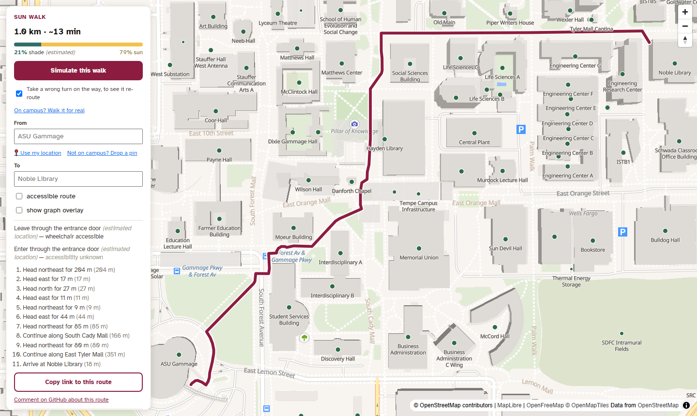
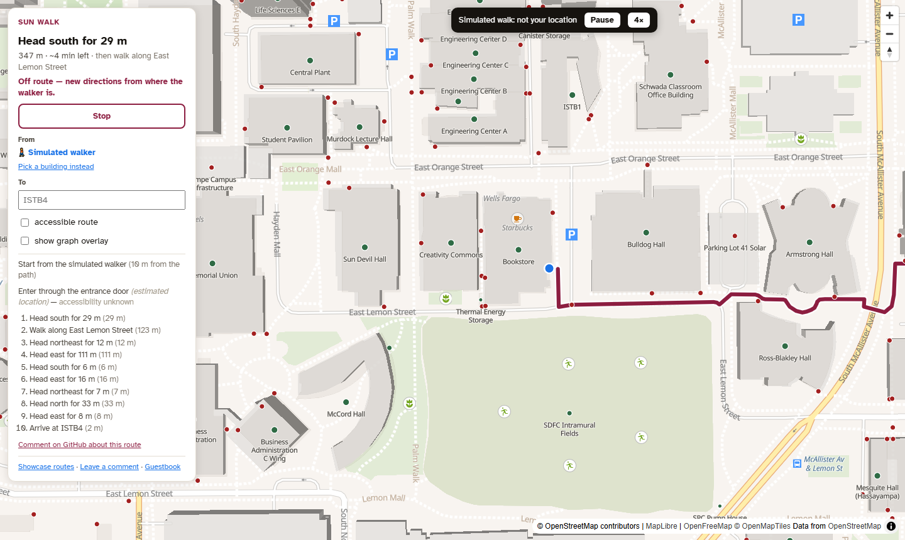

# Sun Walk

**Walking directions for the ASU Tempe campus that pick the right door, can avoid stairs, and show how much of the walk is in shade.**

General maps route you to a building's centre and stop. Sun Walk is built on its own pedestrian graph: real entrances on each building's outline, paths and crossings, stairs and ramps. It routes door to door, and an accessible route is a different route, not a checkbox.

  <a href="https://sun-walk-demo.pages.dev/"><b>▶ Try the live map</b></a>
  &nbsp;·&nbsp;
  <a href="https://github.com/aamoha44/sun-walk-demo/issues/new/choose"><b>💬 Leave a comment</b></a>
  &nbsp;·&nbsp;
  <a href="https://github.com/aamoha44/sun-walk-demo/discussions"><b>📖 Sign the guestbook</b></a>

You don't need to be on campus. The map opens with three routes to try. On any route:
- **Simulate this walk** shows live navigation guiding a simulated walker. It takes a wrong turn on purpose, so you see it notice and re-route.
- **Drop a pin** anywhere on campus to start from there.
- **Comment on GitHub** opens an issue already filled in with that route.

## Try these routes

| Route | What it shows |
|---|---|
| [ASU Gammage → Noble Library](https://sun-walk-demo.pages.dev/?from=GGMA&to=NOBLE) | A walk across campus: each turn, the door at each end, shade along the way |
| [Hayden Library → Wilson Hall, step-free](https://sun-walk-demo.pages.dev/?from=LIB&to=WILSN&stepfree=1) | The short way has stairs. Untick "accessible route" to compare |
| [Memorial Union → ISTB4](https://sun-walk-demo.pages.dev/?from=MU&to=ISTB4) | A walk students make between classes |

Any route you make has a **Copy link** button, so you can send it to someone.

## Where it stands

Every number below is read live from the demo's [`status.json`](https://sun-walk-demo.pages.dev/status.json), which the publish script writes from the test run and the map it just built. None is typed by hand.

| | |
|---|---|
| Tests |  |
| Route-quality gates |  |
| Buildings on the map |  |
| Buildings with a confirmed accessible entrance |  |
| Routes that change with step-free on |  |
| Map version |  |

What the numbers don't say:

- **The route-quality gates are honest, and some fail.** R1 to R4 compare each route with a straight line over hundreds of sampled building pairs. When a gate fails, it means some routes still take a detour a student wouldn't. The fix is better map data, not a looser threshold.
- **Most door locations are estimated.** Where OpenStreetMap has no entrance, the builder places one on the building's outline nearest a path, and the app says "(estimated location)". Doors are being confirmed by walking campus.
- **Shade is estimated** from the buildings beside each path, and the app says so. It isn't surveyed yet.
- **This is a desk demo.** The simulated walk runs the real navigation logic on a made-up GPS trace. Real turn-by-turn on a phone works on campus and is being tested there.

## How it's built

- **A pedestrian graph built from scratch.** A staged Python and SpatiaLite pipeline merges OpenStreetMap paths with ASU's building records. It finds or estimates real doors, repairs paths that cut through buildings, and gives every node and edge an id derived from its content, so ids stay stable across rebuilds. Validation gates fail the build on broken geometry or unreachable buildings.
- **Routing:** bidirectional A* over a compact adjacency, checked against plain Dijkstra for equal cost on hundreds of real pairs. Walking speed, stairs and street crossings all count. The accessible profile also leaves out stairs and slopes steeper than the ADA maximum, and says out loud where accessibility is still unknown.
- **The app:** React, TypeScript and MapLibre GL, a phone-first progressive web app that caches the map for offline use. Directions come with the chosen door at each end and a shade meter.
- **Privacy by design:** your location never leaves your device. Directions are computed in the browser, and a problem report carries route and building ids, never a position.
- **Tested:** unit and pipeline tests run against a frozen fixture graph, and a route-quality report is regenerated whenever the router or the builder changes.

## The code

The source is in a private repository. **A code walkthrough is available on request**, and interviewers can be given read access: [open a discussion](https://github.com/aamoha44/sun-walk-demo/discussions) or ask me directly.

## Leave a comment

- On a route: open it in the map and use **Comment on GitHub**, which fills in the route for you.
- Anything else: [open an issue](https://github.com/aamoha44/sun-walk-demo/issues/new/choose) or sign the [guestbook](https://github.com/aamoha44/sun-walk-demo/discussions).

Comments here are public. Please don't post anything personal, and never your location.

## Data and credits

- **Walking network:** © [OpenStreetMap](https://www.openstreetmap.org/copyright) contributors. The Sun Walk pedestrian graph database is made available under the [Open Database License](http://opendatacommons.org/licenses/odbl/1.0/). Any rights in individual contents of the database are licensed under the [Database Contents License](http://opendatacommons.org/licenses/dbcl/1.0/).
- **Buildings** (outlines, names, categories): ASU University Facility Records Management.
- **Basemap:** [OpenFreeMap](https://openfreemap.org/), © [OpenMapTiles](https://openmaptiles.org/), data from OpenStreetMap.
- **Typeface:** Atkinson Hyperlegible, by the Braille Institute.

This repository's own text and templates are under the [MIT License](LICENSE). Sun Walk is an independent project, not an official ASU service.
